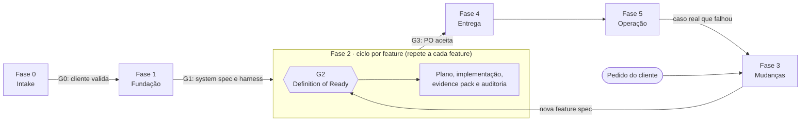
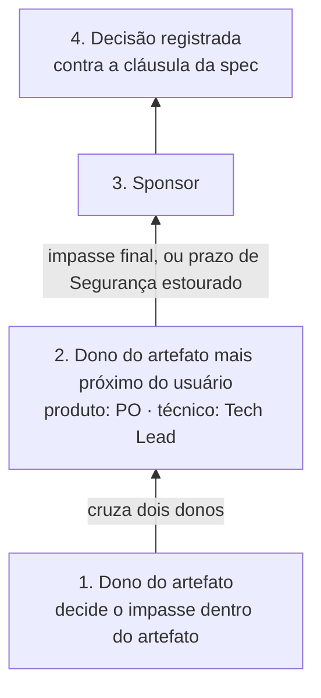
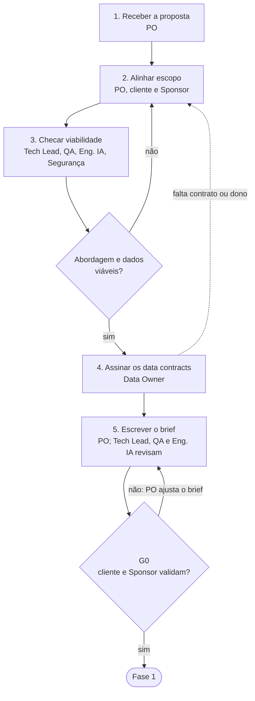
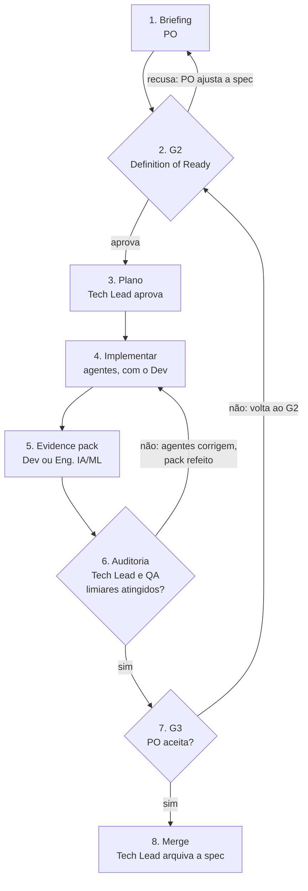
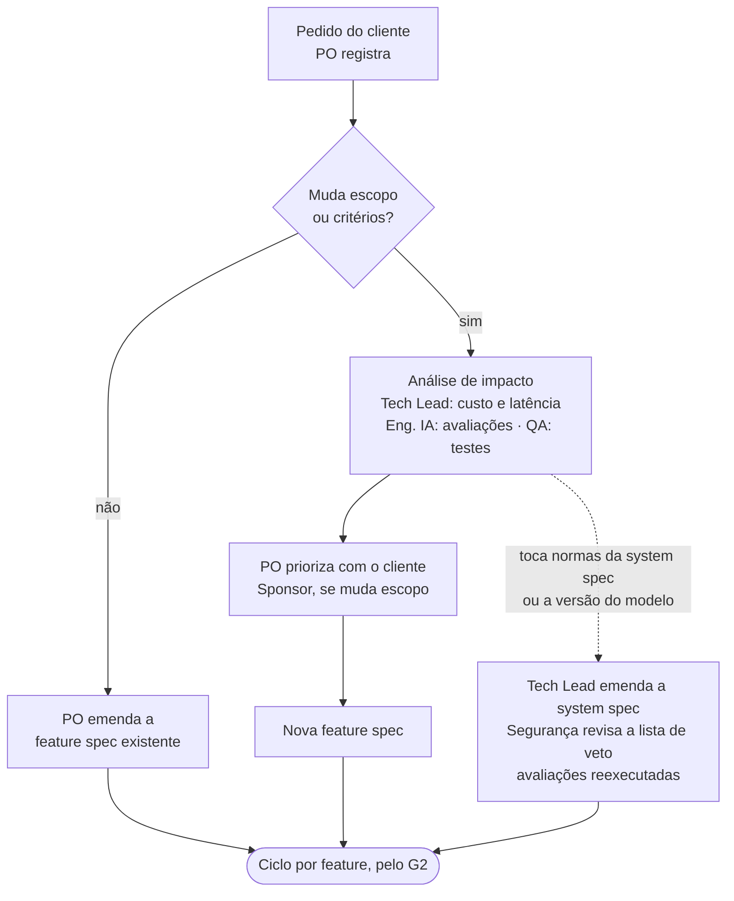
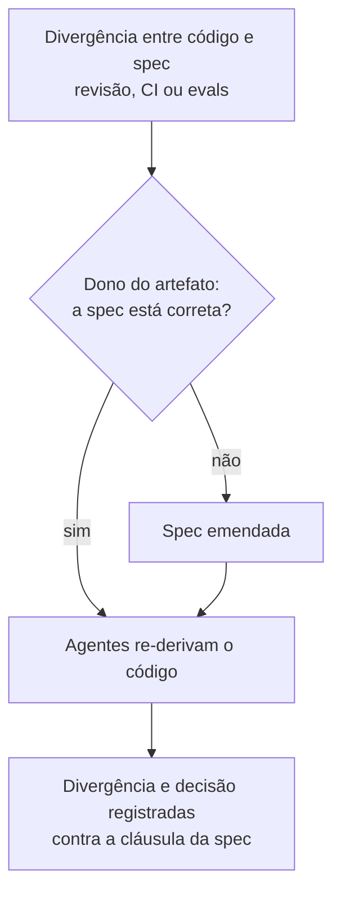
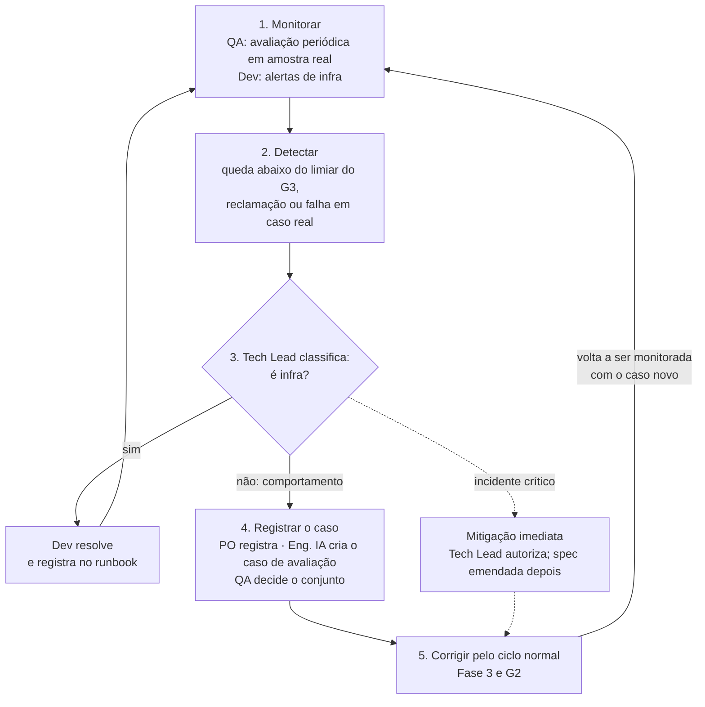

# Framework SDD Startups

Metodologia v2.5 · repositório de referência. Edições só pelo Tech Lead, com entrada em [`CHANGELOG.md`](CHANGELOG.md). Os templates ficam em [`templates/`](templates/).

## Visão geral

O projeto avança em seis fases, e cada passagem exige um gate: só segue quando o cliente, os donos ou as evidências confirmam o que foi combinado. A especificação é o contrato entre os papéis e os agentes; o código é derivado dela, e quando os dois divergem, a spec decide.

A equipe base tem seis papéis: PO, Tech Lead, Dev, QA, Engenheiro de IA/ML e agentes de IA. O Sponsor/cliente e Segurança e Compliance atuam por fora. O ciclo por feature trata dois tipos de feature, de IA e de dados. A Fase 5 cobre a operação depois da entrega.



A Fase 2 se repete a cada feature, e o G2 (Definition of Ready) fica dentro dela. Pedidos novos do cliente entram pela Fase 3 e voltam como nova feature spec. Na Fase 5, casos reais que falham voltam pela Fase 3, e a correção segue o ciclo normal.

## Papéis: quem responde pelo quê

Cada artefato tem um único dono, e quem implementa nunca é quem mede nem quem aceita. O PO responde pelo o quê e para quê. O Tech Lead responde pelo como e pela auditoria. O QA testa o sistema como um todo e mede as avaliações de forma independente. O Engenheiro de IA constrói os datasets e as avaliações. O Tech Lead também responde pela operação. Agentes de IA executam, mas nunca são donos nem aprovam: cada saída de agente é assinada pelo humano que o acionou. A feature spec é o ponto de encontro dos papéis da equipe.

| Papel | Responde por | Assina |
| --- | --- | --- |
| PO | Valor, comportamento esperado, critérios de negócio, prioridade do backlog, aceite | Brief, critérios de aceite da feature, o que é "bom" nos evals, aceite (G3) |
| Tech Lead | Arquitetura, NFRs, plano, decisões técnicas, auditoria do evidence pack; operação (release, observabilidade, runbook, incidentes) | System spec, plano da feature, auditoria no G3, runbook e release |
| Dev (+ agentes) | Implementação, prompts, definições de ferramentas e versão do modelo versionados; execução do release e resolução de incidentes de infra | Evidence pack, código derivado da spec |
| QA | Testes do sistema como um todo (funcionais, integração, ponta a ponta, regressão, carga), ambientes e massa de teste; custódia do conjunto de validação retido e medição final das avaliações | Suíte de testes do sistema, resultados de testes e de avaliação, medição no G3 e na operação |
| Engenheiro de IA / ML | Golden dataset e rubrica operacional (aplicações de IA); datasets de treino, validação e teste e seus splits (modelos treinados); harness de avaliação; limiares técnicos; pipelines e camadas de dados (absorve o Data Engineer) | Golden dataset e datasets versionados, harness de avaliação, origem dos dados de treino |
| Agentes de IA | Tarefas delegadas dentro do nível de autonomia: usados por todos, principalmente por Dev, QA e Engenheiro de IA/ML | Nada: quem os aciona assina a saída |
| Segurança e Compliance (apoio sob demanda) | Guardrails, dados pessoais, permissões dos agentes, conformidade | Veto em lista fechada (abaixo) |
| Sponsor / cliente | Patrocínio, orçamento, escopo, retorno; indica o Data Owner, que responde pela qualidade, significado e acesso das fontes | G0, mudança de escopo, impasses entre donos; data contracts (pelo Data Owner) |

**Veto de Segurança e Compliance.** O veto vale só para uma lista fechada: guardrails e normas na system spec, tratamento de dados pessoais, permissões e limites de ação dos agentes, e troca de modelo ou de provedor em casos regulados. Nos demais temas o papel é consultivo. Se não responder no prazo combinado (sugestão: 3 dias úteis), o gate segue com o risco registrado e escalado ao Sponsor.

Quem faz o quê em cada fase (D = dono, A = aprova, E = executa, C = consultado):

| Fase | PO | Tech Lead | Dev | QA | Eng. IA | Segurança | Sponsor |
| --- | --- | --- | --- | --- | --- | --- | --- |
| 0. Intake | D | C | C | C | C | C | A (G0), D (contratos, via Data Owner) |
| 1. Fundação | A | D | E | E | E | A (guardrails) |  |
| 2. Feature de IA | D (briefing), A (aceite) | A (plano), D (auditoria) | E | D (medição) | D (avaliações), E | C |  |
| 2. Feature de dados | A | A (plano) |  | C | E | C |  D (contrato, via Data Owner) |
| 3. Mudanças | D | C | C | C | C | C | A (se muda escopo) |
| 4. Entrega | D (aceite final) | A, D (release) | E | C | C | C |  |
| 5. Operação | D (casos reais) | A (correções técnicas), D (infra e incidentes) | E | D (avaliação periódica) | E (casos de avaliação) | C |  |

Os agentes de IA executam (E) sob Dev, QA e Engenheiro de IA/ML em todas as fases e não aparecem como dono ou aprovador. A operação fica com Tech Lead e Dev, e os dados de pipeline com o Engenheiro de IA/ML.

**Escalonamento.** Um impasse dentro de um artefato é decidido pelo dono. Se cruza dois donos, decide o dono do artefato mais próximo do usuário (produto: PO; técnico: Tech Lead). O impasse final é do Sponsor. Toda decisão fica registrada contra a cláusula da spec.



O impasse só sobe quando o degrau de baixo não resolve. Estouro de prazo de Segurança e Compliance também vai ao Sponsor.

## Fase 0: Intake e alinhamento com o cliente

A Fase 0 transforma a proposta em escopo, riscos, contratos de dados e critérios de sucesso, e só termina quando o cliente valida esses critérios (G0). O PO lidera o alinhamento e escreve o brief. O Tech Lead avalia a viabilidade técnica e garante que cada critério de sucesso é verificável. O Engenheiro de IA/ML confirma os critérios de modelo (por exemplo, um recall mínimo) e que há dados para o golden dataset ou para treino e teste. O QA confirma os critérios do sistema. O Data Owner, indicado pelo cliente, assina os data contracts das fontes críticas.

1. **Receber a proposta.** O PO lê e organiza.
2. **Alinhar escopo.** O PO, com o cliente e o Sponsor: objetivos, usuários, casos de uso prioritários, critérios de sucesso, fora de escopo.
3. **Checar viabilidade.** O Tech Lead avalia abordagem e riscos e garante que cada critério de sucesso é verificável: o Engenheiro de IA/ML confirma os critérios de modelo (métrica, conjunto de teste, dados rotulados, baseline) e o QA, os critérios do sistema; Segurança e Compliance sinalizam restrições de dados pessoais e conformidade.
4. **Assinar os data contracts.** Para cada fonte crítica, o Data Owner descreve esquema, frescor, completude, acesso e restrições de privacidade. Falta de contrato ou de dono volta ao passo 2.
5. **Escrever o brief.** O PO escreve, o Tech Lead, o QA e o Engenheiro de IA revisam.
6. **G0.** O cliente valida.



Se os dados ou a abordagem não forem viáveis, volta-se ao alinhamento de escopo. Se o trabalho de dados que falta for grande, ele entra no backlog como feature de dados (ver Fase 2) e o escopo é renegociado. Se o cliente não validar o brief, o PO o ajusta.

**G0:** o cliente e o Sponsor validam os critérios de sucesso, o brief está aprovado e os data contracts das fontes críticas estão assinados.

**Insumo opcional.** Uma organização que já avalia a prontidão dos seus dados por outro framework pode anexar essa avaliação ao brief como evidência. O SDD não depende dela.

## Fase 1: Fundação

Antes da primeira feature, o projeto constrói o que todas as features vão herdar. O Tech Lead conduz e o PO valida o que toca negócio. A fase termina quando a system spec é aprovada e o harness de avaliação roda de ponta a ponta, mesmo sobre um sistema vazio (G1).

1. **System spec e arquivo de regras dos agentes** (Tech Lead). Arquitetura, convenções, padrões de erro, regras normativas e guardrails. Vale em toda sessão de agente. Só o Tech Lead aprova mudanças nela.
2. **NFRs transversais** (Tech Lead propõe, PO valida). Segurança, privacidade, disponibilidade, observabilidade, orçamento de custo e latência por requisição. O que divergir do padrão em uma feature entra na feature spec.
3. **Casos de uso prioritários e regras de negócio** (PO). Em linguagem que o agente consiga consumir: exemplos concretos de entrada e saída esperada.
4. **Golden dataset v0 e rubricas.** O PO, com o cliente, define os casos, o critério de "bom" e o limiar. O Engenheiro de IA dá estrutura, escreve a rubrica operacional e versiona; com modelo a treinar, monta também os datasets de treino, validação e teste. O QA separa e guarda o conjunto de validação retido, que quem implementa não vê. O Data Owner aprova o uso de dados reais e a anonimização.
5. **Suíte de testes, harness de avaliação e CI** (QA constrói a suíte de testes do sistema, Engenheiro de IA constrói o harness de avaliação, Dev integra os dois no CI). Roda os testes e os casos de avaliação, calcula as métricas e bloqueia merge quando um teste falha ou um limiar não é atingido.
6. **Permissões e níveis de autonomia dos agentes** (Tech Lead define por classe de tarefa, Segurança e Compliance revisa). O que o agente faz sozinho e o que exige plano aprovado antes de executar.
7. **Observabilidade base e runbook inicial** (Tech Lead com Dev). Logs, métricas e alertas mínimos, para que a Fase 5 não comece do zero.

**G1:** a system spec está aprovada pelo Tech Lead; o PO revisou o que toca negócio e privacidade; Segurança e Compliance aprovou os guardrails; o harness roda de ponta a ponta no CI.

## Fase 2: Ciclo por feature

Uma feature só é aceita depois de passar por G2 e G3, com evidências auditadas pelo Tech Lead, medidas pelo QA e aceitas pelo PO. O ciclo é único para os dois tipos de feature; o que muda é a prova de pronto.

1. **Briefing** (PO). Comportamento, critérios de aceite, exemplos e casos de avaliação, mais as dependências de outras features.
2. **G2, Definition of Ready** (Tech Lead). Confirma que cada critério é verificável, o QA confirma que os testes existem e o Engenheiro de IA, que a avaliação existe. Se não, o PO ajusta a spec.
3. **Plano** (Tech Lead). Plano e tarefas, aprovados antes de os agentes executarem. Tarefas fora do nível de autonomia exigem plano aprovado.
4. **Implementar** (agentes, com o Dev). Diante de ambiguidade, o agente suspende e consulta quem decide (PO para produto, Tech Lead para técnica), e a resposta fica registrada na spec.
5. **Evidence pack** (Dev ou Engenheiro de IA/ML). Testes, avaliações e custo medido.
6. **Auditoria** (Tech Lead e QA). O Tech Lead audita aderência à spec e aos NFRs. O QA roda a suíte de testes e mede as avaliações no conjunto de validação retido. Se algum limiar falha, os agentes corrigem.
7. **G3, Definition of Done** (PO). Aceite contra os critérios de negócio. Se o PO recusa, a feature volta ao G2.
8. **Merge** (Tech Lead). Arquiva a spec e leva as decisões novas para a base de conhecimento do projeto.



O PO ajusta a spec se o G2 recusar. Se a auditoria falhar, os agentes corrigem e o evidence pack é refeito. Se o PO recusar no G3, a feature volta ao G2.

**Tipos de feature.**

|  | Feature de IA | Feature de dados |
| --- | --- | --- |
| Exemplo | Assistente, classificador, extração | Pipeline de ingestão, regra de qualidade, catálogo |
| Dono da prova | Engenheiro de IA (avaliações), QA (testes e medição final) | Data Owner |
| Quem executa | Dev, com agentes; Engenheiro de IA quando há modelo treinado | Engenheiro de IA/ML |
| Critério de aceite | Casos de avaliação com rubrica e limiar | Data contract e regras de qualidade automatizadas |
| DoR (G2) | Comportamento descrito, casos e limiar definidos com o PO, orçamento de custo e latência, restrições técnicas, dependências declaradas | Contrato descrito (esquema, frescor, completude), dono nomeado, regras testáveis, orçamento de custo |
| DoD (G3) | Avaliações atingem o limiar no conjunto de validação, custo e latência no orçamento, guardrails testados, NFRs respeitados | Regras de qualidade passando no CI, pipeline monitorado, contrato atualizado, acesso por perfil |
| Aceite | PO, contra os critérios de negócio | PO contra o valor de negócio; Data Owner confirma a qualidade |

Uma feature de IA declara de quais features de dados depende. Enquanto elas não passam o G3, a feature de IA pode ser desenvolvida como spike com amostra de dados, marcado "não produtivo", e não vai para produção.

## Particularidades de um sistema de IA

Num sistema de IA o comportamento não é determinístico, então “pronto” deixa de ser “o teste passou” e vira “a avaliação atingiu o limiar combinado”. Sete ajustes valem em todas as fases:

- **Evals são spec executável.** O PO e o cliente definem os casos, o critério de negócio e o limiar. O Engenheiro de IA implementa a rubrica operacional e o harness; o QA mede no conjunto retido.
- **Desenvolvimento e validação ficam separados.** O QA detém o conjunto de validação retido. Dev, Engenheiro de IA e agentes só veem o conjunto de desenvolvimento, para que o sistema não seja ajustado só para passar nos exemplos conhecidos.
- **Modelo treinado tem datasets próprios.** Quando o projeto treina ou ajusta um modelo, o Engenheiro de IA monta os datasets de treino, validação e teste e registra a origem de cada um; o Data Owner aprova o uso. O conjunto de teste final fica com o QA e nunca entra em treino.
- **Prompts, definições de ferramentas e versão do modelo são artefatos versionados.** Qualquer mudança exige rodar a avaliação de novo e comparar com a versão anterior.
- **Guardrails são normas na system spec.** Recusas, tratamento de dados pessoais e limites de domínio ficam escritos como regras sempre ativas, com teste correspondente, e não como instruções soltas num prompt. Segurança e Compliance aprova.
- **Custo e latência são requisitos por feature.** Cada feature spec declara seu orçamento, e o evidence pack mostra o consumo medido.
- **A produção alimenta a spec.** Casos reais que falharam viram novos casos de avaliação, via PO, Engenheiro de IA e QA, e passam pelo mesmo ciclo.

Trocar de modelo ou de provedor é mudança com impacto de spec, não detalhe de implementação: segue o fluxo de mudanças e, em casos regulados, tem veto de Segurança e Compliance.

## Fase 3: Mudanças e deriva de spec

Todo pedido novo vira spec antes de virar código, e quando spec e código discordam, a spec decide.

1. O PO registra o pedido e decide se ele muda escopo ou critérios.
2. Se não muda, o PO emenda a feature spec existente.
3. Se muda, o Tech Lead analisa o impacto em custo, latência e avaliações, e o Engenheiro de IA estima o impacto nos casos de avaliação e o QA, nos testes. O PO prioriza com o cliente. Mudança de escopo passa pelo Sponsor. A dupla escreve uma nova feature spec, que entra no ciclo pelo G2.
4. Se toca normas da system spec ou a versão do modelo, o Tech Lead emenda a system spec, Segurança e Compliance revisa o que está na lista de veto, e as avaliações são reexecutadas antes do G2.



Pedido que não muda escopo só emenda a spec. Pedido que muda passa por impacto e prioridade antes de virar nova spec.

Quando código e spec divergem (por revisão, CI ou evals), o dono do artefato decide se a spec está correta. Se estiver, os agentes re-derivam o código. Se não, a spec é emendada e depois re-derivada. Ninguém edita em silêncio: a divergência e a decisão ficam registradas contra a cláusula da spec.



## Fases 4 e 5: Entrega e Operação

**Fase 4, Entrega.** O PO demonstra ao cliente e coleta o aceite final. O Dev faz o release e o Tech Lead confirma observabilidade, alertas e runbook. O Tech Lead confirma que o sistema em produção corresponde à spec arquivada. A entrega termina com o sistema sob a responsabilidade da Fase 5.

**Fase 5, Operação.** Depois da entrega, a responsabilidade se divide em dois eixos:

- **Tech Lead e Dev:** disponibilidade, infraestrutura, alertas e resposta a incidentes. Incidente de infra é resolvido pelo Dev, sob o Tech Lead, e registrado no runbook.
- **PO, QA e Engenheiro de IA:** qualidade de comportamento, ou seja, drift, regressão de qualidade e falhas de resposta. O QA roda avaliação periódica sobre uma amostra de tráfego real, com os mesmos limiares do G3. O PO responde pelos casos reais.

O ciclo de comportamento funciona assim:

1. **Monitorar.** O QA roda a avaliação periódica sobre a amostra de tráfego real. O Dev acompanha os alertas de infra. A amostragem respeita as regras de dados pessoais da system spec e passa pelo Data Owner.
2. **Detectar.** Queda abaixo do limiar do G3, reclamação de usuário ou falha em caso real abre um incidente de comportamento.
3. **Classificar.** O Tech Lead classifica o incidente: se é infra, o Dev resolve. Se é comportamento, segue os passos abaixo.
4. **Registrar o caso.** O PO registra o caso real que falhou, e o Engenheiro de IA o transforma em caso de avaliação; o QA decide se ele entra no conjunto de desenvolvimento ou no de validação.
5. **Corrigir pelo ciclo normal.** A correção é uma feature ou emenda de spec pela Fase 3 e entra no G2. Em incidente crítico, o Tech Lead pode autorizar mitigação imediata (por exemplo, reverter a versão do prompt ou do modelo); a spec é emendada logo depois, sem deixar a mitigação sem registro.



O ciclo fecha quando a correção volta a ser monitorada com o mesmo conjunto de avaliação, agora com o caso novo.

**Revisão periódica.** A cada trimestre, o Tech Lead, o Engenheiro de IA e o QA revisam a system spec, os limiares e a versão do modelo contra o que a produção mostrou, e o Tech Lead revisa o runbook.

## Artefatos, donos e gates

Todo artefato tem um dono, vive no repositório junto do código e só avança passando por um gate.

| Artefato | Dono | Gate para avançar |
| --- | --- | --- |
| Brief e critérios de sucesso do projeto | PO | Cliente e Sponsor validam (G0) |
| Data contract de cada fonte crítica | Data Owner | Tech Lead confirma viabilidade; fechado no G0 |
| System spec e arquivo de regras dos agentes | Tech Lead | PO revisa o que toca negócio; Segurança aprova guardrails; harness rodando (G1) |
| Permissões e níveis de autonomia dos agentes | Tech Lead | Segurança e Compliance revisa (G1) |
| Golden dataset: casos, critério de negócio e limiar | PO, com o cliente | Engenheiro de IA confirma que são mensuráveis; versão registrada |
| Golden dataset (estrutura e rubrica operacional) e datasets de treino, validação e teste | Engenheiro de IA | Data Owner aprova uso de dados reais; QA recebe o conjunto retido |
| Conjunto de validação retido | QA | Separado antes do primeiro G2; nunca usado em treino nem visto por quem implementa |
| Suíte de testes, harness de avaliação e CI | QA (testes do sistema), Engenheiro de IA (avaliações), Dev (integração) | Roda de ponta a ponta (G1) |
| Feature spec | PO (comportamento, critérios) e Tech Lead (restrições, testabilidade) | Definition of Ready (G2) |
| Mapa de dependências entre features | Tech Lead | Atualizado antes do G2 de cada feature |
| Plano e tarefas | Tech Lead | Tech Lead aprova antes de os agentes executarem |
| Decisões e consultas resolvidas | Quem decide: PO (produto), Tech Lead (técnico) | Registradas contra a cláusula da spec |
| Prompts, ferramentas e versão do modelo | Dev ou Engenheiro de IA | Avaliação sem regressão, medida pelo QA |
| Evidence pack | Dev (IA) ou Engenheiro de IA/ML (dados) | Tech Lead audita, QA mede, PO aceita (G3) |
| Runbook e observabilidade | Tech Lead | Confirmado na entrega (Fase 4) |
| Decisão que cruza artefatos | Quem decide: PO (produto), Tech Lead (técnico), Sponsor (impasse final) | Registrada em `.sdd/decisions/`, ligada à cláusula |
| Ledger de gates e registros de aprovação | PO e Tech Lead (ledger); PO registra a aprovação externa | Cada aprovador escreve a própria linha |
| Incidente de comportamento e caso real | PO (registro), Engenheiro de IA (caso de avaliação), QA (conjunto de destino) | Entra pelo ciclo normal, no G2 |

**Definition of Ready (G2):** a feature spec tem comportamento descrito, critérios de aceite testáveis ou avaliáveis, exemplos, orçamento de custo e latência, restrições técnicas e dependências declaradas. O Tech Lead confirmou que cada critério pode ser verificado e o QA confirmou que os testes existem e o Engenheiro de IA, que a avaliação existe.

**Definition of Done (G3):** o evidence pack mostra testes e avaliações atingindo os limiares no conjunto de validação, consumo de custo e latência dentro do orçamento, NFRs respeitados, rationale da abordagem e link para a versão da spec. O PO aceita contra os critérios de negócio, a spec é arquivada e as decisões novas vão para a base de conhecimento do projeto.

## Anexo: templates dos artefatos e estrutura do repositório

Cada artefato tem um template em Markdown em [`.sdd/framework/templates/`](templates/), para que o PO preencha sem ferramenta especial e o agente leia direto. Cada seção de um template existe porque um gate a exige, e um comentário no início da seção diz qual.

| Template | Caminho final | Fase | Gate | Dono (preenche) | Quem aprova |
| --- | --- | --- | --- | --- | --- |
| `01-brief.md` | `.sdd/brief.md` | 0 Intake | G0 | PO | Cliente e Sponsor |
| `03-data-contract.md` | `.sdd/contracts/DC-001-<fonte>.md` | 0 Intake e features de dados | G0, G2 | Data Owner | Tech Lead confirma viabilidade; Segurança revisa dados pessoais |
| `04-system-spec.md` | `.sdd/system-spec.md` | 1 Fundação | G1 | Tech Lead | PO (negócio), Segurança (guardrails e permissões) |
| `02-feature-spec.md` | `.sdd/features/FEAT-001-<slug>/spec.md` | 2 Ciclo por feature | G2, G3 | PO e Tech Lead | Tech Lead, QA e Engenheiro de IA no G2 |
| `07-plano.md` | `.sdd/features/FEAT-001-<slug>/plan.md` | 2 Ciclo por feature | Aprovação do plano; revisão de cada task | Tech Lead, com o agente | Tech Lead aprova o plano; Dev aprova cada task |
| `05-evidence-pack.md` | `.sdd/features/FEAT-001-<slug>/evidence-pack.md` | 2 Ciclo por feature | G3 | Dev ou Engenheiro de IA/ML | Tech Lead audita, QA mede, PO aceita |
| `06-incidente-comportamento.md` | `.sdd/incidents/INC-001-<slug>.md` | 5 Operação | entra pelo G2 | PO, QA e Engenheiro de IA | Tech Lead |
| `08-decisao.md` | `.sdd/decisions/DEC-001-<slug>.md` | Todas | registro contra a cláusula | Quem decide | Quem decide |
| `09-gates.md` | `.sdd/gates.md` | Todas | G0 a G3 | PO e Tech Lead | Cada aprovador, na própria linha |
| `10-aprovacao.md` | `.sdd/approvals/APR-001-<slug>.md` | 0 Intake, G2 | G0, G2 | PO registra | Cliente, Sponsor ou Data Owner |

**Regra de uso.** Copie o template para o caminho final em `.sdd/` e nunca edite o original. Campo sem resposta vira pergunta em aberto no próprio documento. Escreva para o agente: prefira exemplos concretos de entrada e saída a descrições gerais. Uma mudança em um template entra no [`CHANGELOG.md`](CHANGELOG.md), aprovada pelo Tech Lead.

**Estrutura do repositório.** Um repositório por startup. Tudo o que é processo fica em `.sdd/`; só `AGENTS.md` e `CLAUDE.md` ficam na raiz, porque as ferramentas os procuram ali. O código vive num workspace uv, com `packages/*` como membros (o esqueleto é criado na Fase 1).

```text
AGENTS.md                      regras invioláveis dos agentes (CLAUDE.md importa este)
.sdd/
  framework/                   esta metodologia, templates e CHANGELOG; dono: Tech Lead
  brief.md                     Fase 0
  gates.md                     ledger dos gates G0 a G3, com links para as evidências
  contracts/                   DC-001-<fonte>.md, um por fonte de dados
  decisions/                   DEC-001-<slug>.md, decisões que cruzam artefatos
  approvals/                   registros externos de aprovação (cliente, Sponsor, Data Owner)
  system-spec.md               Fase 1
  evals/
    dev/                       conjunto de desenvolvimento, visível aos agentes
    validation.md              só o contrato e o hash do conjunto retido
  features/FEAT-001-<slug>/{spec,plan,evidence-pack}.md
  incidents/INC-001-<slug>.md
packages/                      membros do workspace uv: código derivado da spec (inclui eval-harness)
pyproject.toml                 raiz do workspace uv (Fase 1)
```

Convenções: nomes de arquivo e pasta em inglês, minúsculos, com hífen; conteúdo em português. IDs: `FEAT-`, `DC-`, `INC-`, `DEC-` mais número. O `Status` de cada artefato usa o vocabulário fechado de [`CHANGELOG.md`](CHANGELOG.md). A aprovação é escrita pelo humano no próprio artefato (nome, papel, data) e resumida em `gates.md`; aprovações do cliente, do Sponsor e do Data Owner entram como registro anexado em `approvals/`. O conjunto de validação retido nunca entra no repositório: fica sob custódia do QA, e só o harness no CI o lê. A feature aceita (G3) não muda de pasta; o `Status` da `spec.md` passa a `arquivada`.

## Métricas do processo e adoção

A metodologia é uma proposta sem validação empírica, então ela é introduzida em um piloto e medida desde o primeiro ciclo. O piloto roda com uma startup do programa, por três ciclos de feature.

| Métrica | O que mostra | Quem acompanha |
| --- | --- | --- |
| Taxa de devolução no G2 | Quantas feature specs voltam ao PO por não serem verificáveis | Tech Lead |
| Taxa de rejeição no G3 | Quantas features o PO recusa depois do evidence pack | PO |
| Tempo de espera de agentes por consulta | Gargalo de PO ou Tech Lead nas decisões | Tech Lead |
| Retrabalho depois do aceite | Defeitos achados após o G3 | QA |
| Defeitos de comportamento que escaparam para produção | Qualidade dos evals e do conjunto de validação | QA |
| Tempo de ciclo, do G2 ao G3 | Fluxo e tamanho das features | Tech Lead |
| Divergências spec e código registradas | Deriva de spec | Tech Lead |
| Prazo de resposta dos papéis de apoio | Gargalo de Segurança e Compliance e do Data Owner do cliente | PO |

**Plano de adoção.**

1. **Escolher o piloto.** Uma equipe com PO, Tech Lead, Dev, QA e Engenheiro de IA nomeados e um projeto real com cliente disponível.
2. **Ciclos 1 a 3.** Cada ciclo é uma feature completa, do G2 ao G3. As métricas são coletadas desde o primeiro ciclo, de forma leve.
3. **Retrospectiva.** Ao fim do terceiro ciclo, o time decide o que cortar, ajustar ou manter, olhando as métricas e os pontos de atrito.
4. **Versionar.** A metodologia ganha versão (v1.0, v1.1) e o histórico de mudanças fica registrado no fim deste documento.
5. **Expandir.** Novas startups do programa entram na versão vigente, e os papéis de apoio são dimensionados pelo prazo de resposta medido.

## Riscos, premissas e histórico

Os riscos principais são gargalos de decisão na equipe e no apoio externo, a qualidade das avaliações e a deriva entre spec e código.

| Risco | Mitigação |
| --- | --- |
| PO ou Tech Lead como gargalo de consultas | Decidir o máximo na spec, agrupar consultas em janelas fixas, combinar tempo de resposta |
| Segurança e Compliance ou Data Owner do cliente como gargalo | Prazo de resposta, veto só em lista fechada, escalonamento ao Sponsor, métrica de prazo |
| Tech Lead sobrecarregado ao acumular a operação | Dev executa release e incidentes de infra; um SRE dedicado volta a ser papel próprio se a operação crescer |
| QA ou Engenheiro de IA como gargalo de avaliação | Harness automatizado, rubricas versionadas, o conjunto cresce com casos reais aos poucos |
| Escopo vago do cliente | A Fase 0 só termina com critérios de sucesso validados |
| Dados indisponíveis ou de baixa qualidade | Data contract assinado na Fase 0, não descoberto na implementação |
| Ajuste excessivo aos casos de avaliação | Conjunto de validação retido com o QA e renovado com casos reais |
| Vazamento entre dados de treino e de teste | Conjunto de teste final com o QA, separado antes do primeiro treino; Engenheiro de IA registra a origem de cada dataset |
| Deriva entre spec e código | A spec decide; re-derivar ou emendar, nunca edição silenciosa |
| Spike que vira entrega | Marca "não produtivo" e bloqueio até as dependências de dados passarem o G3 |
| Qualidade cai em produção sem ninguém ver | Avaliação periódica do QA em amostra real, com os limiares do G3 |
| Dependência de um provedor de modelo | Versão do modelo como artefato versionado, com avaliação de regressão |

**Premissas assumidas.** O cliente está disponível para validar critérios e casos de referência. A equipe usa agentes de código com repositório e CI. Segurança e Compliance e o Data Owner do cliente têm capacidade para respeitar o prazo de resposta. A metodologia é uma proposta do autor, construída a partir da literatura cinzenta sobre SDD, sem validação empírica; o piloto de três ciclos existe para suprir isso.

**Pontos em aberto.**

- Evals mais rigorosas: como definir limiares, tratar não-determinismo e calibrar juízes automáticos.
- Rigor proporcional ao risco do sistema (níveis de criticidade que mudem gates e evidências).
- Segurança dos agentes: segredos, injeção de prompt e limites de ação, além do nível de autonomia.
- Regras de falha repetida de gate e de exceção formal.

**Histórico de versão.**

| Versão | Data | Mudança |
| --- | --- | --- |
| v1.0 | 2026-11-11 | Primeira versão, PO e Dev, fases 0 a 4 |
| v2.0 (rascunho) | 2026-11-13 | Oito papéis, squad e papéis do projeto, data contracts, tipos de feature, Fase 5 de operação, métricas e piloto |
| v2.1 (rascunho) | 2026-11-13 | Oito diagramas de fluxo e anexo com os templates dos artefatos (templates/sdd/, v1.0) |
| v2.2 (rascunho) | 2026-11-16 | Engenheiro de IA no squad (golden dataset, datasets de treino e teste, harness de avaliação); QA passa a cobrir os testes do sistema como um todo e mantém a custódia do conjunto retido. Equipe base reduzida a seis papéis (PO, Tech Lead, Dev, QA, Engenheiro de IA/ML, agentes de IA); SRE absorvido por Tech Lead e Dev, Data Engineer pelo Engenheiro de IA/ML, Data Owner do lado do cliente, Segurança e Compliance como apoio sob demanda |
| v2.3 (rascunho) | 2026-11-16 | Renomeado para Framework SDD Startups: uma equipe por startup do programa; removidas as regras de múltiplos squads (Tech Lead do projeto, PO líder, paralelismo entre squads); Tech Lead garante a verificabilidade dos critérios na Fase 0 |
| v2.4 | 2026-11-16 | Metodologia passa a viver no repositório (`.sdd/framework/`), com diagramas em Mermaid. Template 07 (plano) incluído; templates v1.1; incidente de comportamento com dono PO, QA e Engenheiro de IA; conjunto de validação retido fora do repositório; estrutura `framework/`, `sdd/`, `evals/`, `src/` |
| v2.5 | 2026-11-18 | Todo o material do processo passa a viver numa única pasta oculta, `.sdd/`, e o código fica num workspace uv (`packages/*`). Novos artefatos: decisão (DEC), ledger de gates e registro de aprovação externa. Vocabulário fechado de `Status`. Templates v1.2 |
